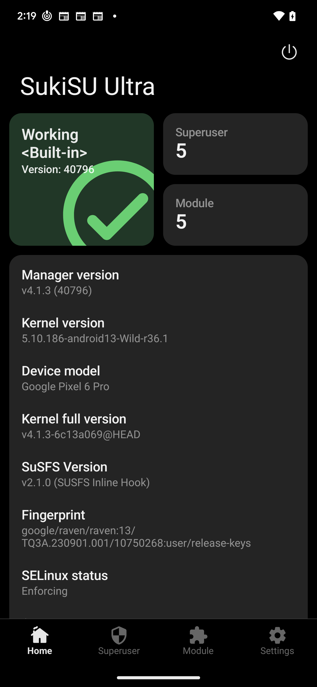
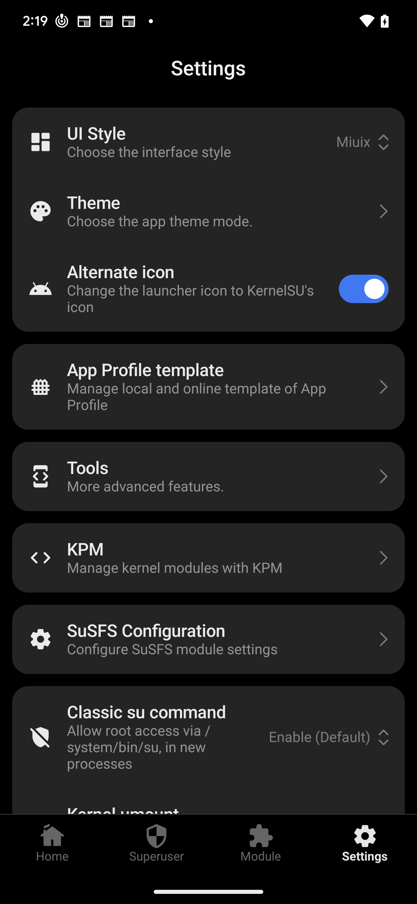
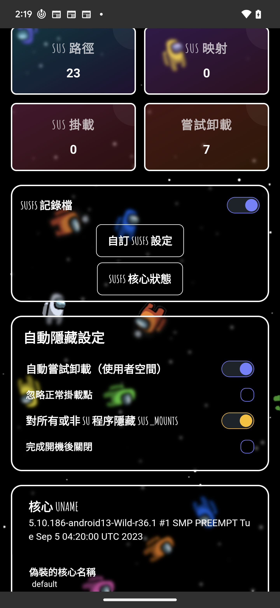

<div align="center">

# 🔥 SukiSU (Wild) GKI Kernels for Android

**GKI 2.0 kernel builds with SukiSU Nova (built-in root), KPM, and SUSFS — for Pixel 6 Pro, Pixel 6a, and other GKI devices.**

[](https://source.android.com/docs/core/architecture/kernel/gki)
[](https://github.com/SukiSU-Nova/SukiSU-Nova/releases/tag/v3.0.0)
[](https://github.com/KernelSU-Next/KPatch-Next)
[](https://gitlab.com/simonpunk/susfs4ksu)

</div>

## 🌐 Language

- English: [README.md](README.md)
- 繁體中文: [README_zh-TW.md](README_zh-TW.md)

## 📌 About this project

This repository automates **Generic Kernel Image (GKI 2.0)** builds for Android 12+ (kernel 5.10 and newer). Each release integrates:

- **SukiSU Nova** — built-in root driver (not LKM/module mode)
- **KPM** ([KPatch-Next](https://github.com/KernelSU-Next/KPatch-Next) 0.13.5-2) — `kptools-linux` + `kpimg-linux` embedded into `Image` at build time
- **SUSFS** — kernel patches plus the matching userspace module

The primary goal is to let **Google Pixel 6 Pro** (`raven`) and **Pixel 6a** (`bluejay`) stay on a flashable GKI kernel that works with the pinned **SukiSU Nova v3.0.0** manager, KPM modules, and ReSuSFS — without relying on stock/vendor kernels or outdated root stacks.

> **Note:** Workflow token `KSUN` is a legacy name from the KernelSU era; in this repo it always means **SukiSU Nova** integration.

## ⚠️ Your warranty is no longer valid!

I am **not responsible** for bricked devices, damaged hardware, or any issues that arise from using this kernel.

**Please** do thorough research and fully understand the features included in this kernel before flashing it!

By flashing this kernel, **YOU** are choosing to make these modifications. If something goes wrong, **do not blame me**!

---

### 🚨 Proceed at your own risk!

---

## 🔧 Wild Kernels family

| Build line | Repository | Status |
|------------|------------|--------|
| 🏗️ **GKI** (this repo) | [GKI_KernelSU_SUSFS](https://github.com/WildKernels/GKI_KernelSU_SUSFS) | ✅ Active — SukiSU Nova + KPM + SUSFS |
| 👑 **Sultan** | [Sultan_KernelSU_SUSFS](https://github.com/WildKernels/Sultan_KernelSU_SUSFS) | ✅ Active |
| 📱 **OnePlus** | [OnePlus_KernelSU_SUSFS](https://github.com/WildKernels/OnePlus_KernelSU_SUSFS) | ✅ Active |

Repository names still contain `KernelSU` for historical reasons; **this GKI line targets SukiSU Nova**, not the original KernelSU manager or LKM workflow.

---

## 🔗 Additional Resources

- 🩹 [Kernel Patches](https://github.com/WildKernels/kernel_patches)
- 📜 [Old Build Scripts](https://github.com/TheWildJames/kernel_build_scripts)
- 📲 [Horizon Kernel Flasher](https://github.com/libxzr/HorizonKernelFlasher) (recommended: flash `*-AnyKernel3-normal.zip`)
- ⚡ [Kernel Flasher](https://github.com/fatalcoder524/KernelFlasher) (advanced: A/B slot backup / restore)

---

## 📋 Installation Instructions

For GKI flashing concepts and manager setup, see:

📖 **[SukiSU Nova Installation Guide](https://github.com/SukiSU-Nova/SukiSU-Nova/releases/tag/v3.0.0)** (GKI / AnyKernel3 method)

### Supported versions (match these; do not mix)

| Component | Version | Download |
|----------|---------|----------|
| 🔐 **SukiSU Nova manager** | **v3.0.0** (versionCode `30000`) | [SukiSU-Nova v3.0.0](https://github.com/SukiSU-Nova/SukiSU-Nova/releases/tag/v3.0.0) |
| 🧠 **SukiSU kernel driver** | **builtin** `4bec532dd` (same handshake as manager v3.0.0) | Built into this kernel |
| 🧩 **KPM** (KPatch-Next 0.13.5-2) | (`kptools-linux` + `kpimg-linux`) | [KPatch-Next](https://github.com/KernelSU-Next/KPatch-Next) |
| 🛡️ **Kernel SuSFS** | **v2.4.0** (`d480b312` on `android13-5.10`), built in | [susfs4ksu](https://gitlab.com/simonpunk/susfs4ksu) |
| 📦 **ReSuSFS** | **v26.10.23** (userspace module for the built-in SuSFS) | [ReSuSFS v26.10.23](https://github.com/ahmed-alnassif/ReSuSFS/releases/tag/v26.10.23) |

Use Manager **v3.0.0** with this kernel. KPM tools ([KPatch-Next](https://github.com/KernelSU-Next/KPatch-Next) 0.13.5-2) live in [`KPatch-Next/`](KPatch-Next/readme.md) and are embedded into `Image` at build time. SukiSU_KernelPatch_patch 0.14.0 was dropped: on Pixel 6 Pro it hangs before Linux starts on most boots (see `KPatch-Next/readme.md`). The Nova manager therefore shows **KPM: Unsupported**; manage KPM with KPatch-Next-Module. Kernel SuSFS stays in the image. ReSuSFS configures that interface; its prebuilt `susfs_guard_lkm` is for stock GKI and will not load on this kernel. Default SUSFS pins are tracked in `.github/config/commits.json`; **android13-5.10** is the first verified target for this branch.

### What this build supports (verified)

This kernel targets **SukiSU Nova v3.0.0** on **android13-5.10**, plus **KPM**, built-in **SUSFS v2.4.0**, and **ReSuSFS v26.10.23**.

Verified on **Pixel 6 Pro** (`raven` / `TQ3A.230901.001`) after flash: `uname -r` → `5.10.186-android13-Wild-r36.1`.

**Pixel 6a** (`bluejay`) uses the same GKI stack (`android13-5.10` + matching OS patch level). Pick the build whose `date` matches your firmware security patch — same rules as Pixel 6 Pro below.

### 1. Which file to download

A successful workflow run uploads **one** flashable artifact, for example:

`5.10.186-android13-2023-09-r36.1-AnyKernel3-normal.zip`

Download it and flash it in Horizon. There is no extra wrapper zip, no `*-bypass`, and no raw `*-AnyKernel3` tree.

### 2. Flash `*-AnyKernel3-normal.zip` with Horizon

Verified tool: [Horizon Kernel Flasher v1.3](https://github.com/libxzr/HorizonKernelFlasher/releases/tag/v1.3)

Prerequisites:

- Unlocked bootloader
- The phone **already has root** (Horizon needs root — existing Magisk, SukiSU LKM, or other KSU-family LKM is fine)
- Copy `*-AnyKernel3-normal.zip` onto the device

Steps:

1. Install `HorizonKernelFlasher-v1.3.apk` and grant it root in **SukiSU Nova** (or your current root manager).
2. Open Horizon and select `*-AnyKernel3-normal.zip` (for example `5.10.186-android13-2023-09-r36.1-AnyKernel3-normal.zip`).
3. Flash the active slot, then reboot.
4. Confirm the kernel:

```bash
adb shell uname -a
# Expect something like: Linux localhost 5.10.186-android13-Wild-r36.1 #1 SMP PREEMPT ... aarch64 Toybox
```

If you are currently on LKM root (stock kernel + loadable module), back up `boot` before flashing GKI. Pixel 6 / 6 Pro / 6a have no separate `init_boot`; the kernel lives in `boot`.

Alternative: [Kernel Flasher](https://github.com/fatalcoder524/KernelFlasher) can flash the same zip to the active slot (Backup first).

### Recommended Modules (KPM + ReSuSFS)

After the kernel boots and SukiSU shows built-in (KPM shows Unsupported in Nova; that is expected), install these three modules in the manager:

- [Zygisk Next](https://github.com/Dr-TSNG/ZygiskNext)
- [KPatch-Next Module](https://github.com/KernelSU-Next/KPatch-Next-Module)
- [ReSuSFS v26.10.23](https://github.com/ahmed-alnassif/ReSuSFS/releases/tag/v26.10.23)

ReSuSFS talks to the SuSFS already built into this kernel. Do not rely on its LKM download path.

### Recommended Root Manager

Use **[SukiSU Nova Manager v3.0.0](https://github.com/SukiSU-Nova/SukiSU-Nova/releases/tag/v3.0.0)** (versionCode `30000`). The kernel driver is pinned to SukiSU Nova **builtin** commit `4bec532dd`.

### Verified working state (Pixel 6 Pro / 6a)

On Pixel 6 Pro (`raven` / `TQ3A.230901.001`) after flashing `5.10.186-android13-Wild-r36.1`: SukiSU Nova shows Working \<Built-in\>; Settings lists **KPM** and **SuSFS Configuration**; the SUSFS WebUI can read the kernel uname. Pixel 6a (`bluejay`) follows the same manager/module stack once the matching `android13-5.10` + patch-level zip is flashed.

| Home (Built-in + SuSFS) | Settings (KPM / SuSFS) | SUSFS WebUI |
|--------------------------|-------------------------|-------------|
|  |  |  |

---

## 🧭 OS Patch Level Mapping (Important)

The `date` field in each build matrix config (for example, `.github/config/android13-5.10.json`) is not only a label.
It is passed into the kernel source fetch step as `os_patch_level` and used to select the upstream branch:

- `common-android13-5.10-2023-09`
- `common-android13-5.10-2025-07`

This is why you can see multiple builds with the same sublevel (such as `5.10.107`) but different dates.
Each date points to a different monthly kernel branch.

### Why this matters

If your device firmware/vendor stack is from one patch level, flashing a kernel built from a much newer or older patch level can cause boot failure.

### Practical guidance

- Match build date to your ROM patch level first.
- For Pixel 6 Pro / 6a on Android 13, start with `android13-5.10` + the `date` that matches `ro.build.version.security_patch` (e.g. `2023-09` for `raven-tq3a.230901.001`).
- Flash `*-AnyKernel3-normal.zip`.

### Pixel 6 Pro / 6a fixed examples

| Device | Codename | Example fingerprint | Suggested matrix |
|--------|----------|---------------------|------------------|
| Pixel 6 Pro | `raven` | `google/raven/raven:13/TQ3A.230901.001/...` | `android13-5.10` + `2023-09` |
| Pixel 6a | `bluejay` | match your `getprop ro.build.fingerprint` patch month | `android13-5.10` + same `YYYY-MM` as security patch |

### Use ADB to determine `kernel_build_version` and `os_patch_level_filter`

Check device values first:

```bash
adb shell getprop ro.build.version.release
adb shell uname -r
adb shell getprop ro.build.version.security_patch
```

Mapping rules:

- `kernel_build_version`
	- Android version comes from `ro.build.version.release`.
	- Kernel major/minor comes from the `uname -r` prefix, for example `5.10.186-android13-...` => `5.10`.
	- Example: Android 13 + kernel 5.10 => `android13-5.10`.
- `os_patch_level_filter`
	- Use year-month from `ro.build.version.security_patch`, for example `2023-09`.

Quick one-liner:

```bash
adb shell 'echo "android=$(getprop ro.build.version.release) kernel=$(uname -r) patch=$(getprop ro.build.version.security_patch)"'
```

SukiSU Nova + SUSFS + KPM (default):

```yaml
release_type: Action
kernel_build_version: android13-5.10
os_patch_level_filter: "2023-09"
feature_set: KSUN+SUSFS
runner_label: "gki-local"
quick_mode: "true"
use_kpm: "true"
```

How to read the SukiSU app result:

- The SukiSU Nova v3.0.0 app should detect built-in mode. KPM shows Unsupported there; check KPatch-Next with `su -c "dmesg | grep 'KP KernelPatch Version'"` (expect `d05`) or the KPatch-Next-Module status line.
- The workflow always uses SukiSU Nova builtin `4bec532dd` — there is no branch override input.

### Valid values for `os_patch_level_filter` (Action input)

Use one of the dates below in the Action input `os_patch_level_filter`.
If left empty, the workflow builds all dates for the selected kernel version.

- [android12-5.10.json](.github/config/android12-5.10.json): `2021-08, 2021-09, 2021-10, 2021-11, 2021-12, 2022-01, 2022-02, 2022-03, 2022-04, 2022-05, 2022-06, 2022-07, 2022-08, 2022-09, 2022-10, 2022-11, 2022-12, 2023-01, 2023-02, 2023-03, 2023-04, 2023-05, 2023-06, 2023-07, 2023-09, 2023-11, 2024-01, 2024-03, 2024-05, 2024-08, 2024-11, 2025-02, 2025-05, 2025-06, 2025-09, 2025-12, 2026-04, lts`

- [android13-5.10.json](.github/config/android13-5.10.json): `2022-04, 2022-05, 2022-06, 2022-07, 2022-08, 2022-09, 2022-10, 2022-11, 2022-12, 2023-01, 2023-02, 2023-03, 2023-04, 2023-05, 2023-06, 2023-07, 2023-08, 2023-09, 2023-10, 2023-11, 2023-12, 2024-01, 2024-02, 2024-03, 2024-04, 2024-05, 2024-06, 2024-07, 2024-08, 2024-09, 2024-11, 2025-01, 2025-03, 2025-05, 2025-07, 2025-10, 2026-01, 2026-04, lts`

- [android13-5.15.json](.github/config/android13-5.15.json): `2022-06, 2022-07, 2022-08, 2022-09, 2022-10, 2022-11, 2022-12, 2023-01, 2023-02, 2023-03, 2023-04, 2023-05, 2023-06, 2023-07, 2023-08, 2023-09, 2023-10, 2023-11, 2023-12, 2024-01, 2024-02, 2024-03, 2024-04, 2024-05, 2024-06, 2024-07, 2024-08, 2024-09, 2024-11, 2025-01, 2025-03, 2025-05, 2025-07, 2025-09, 2025-12, 2026-03, 2026-06, lts`

- [android14-5.15.json](.github/config/android14-5.15.json): `2023-06, 2023-08, 2023-09, 2023-11, 2024-01, 2024-02, 2024-03, 2024-04, 2024-05, 2024-06, 2024-07, 2024-08, 2024-09, 2024-11, 2025-01, 2025-03, 2025-05, 2025-07, 2025-10, 2026-01, 2026-04, lts`

- [android14-6.1.json](.github/config/android14-6.1.json): `2023-06, 2023-07, 2023-08, 2023-09, 2023-10, 2023-11, 2023-12, 2024-01, 2024-02, 2024-03, 2024-04, 2024-05, 2024-06, 2024-07, 2024-08, 2024-09, 2024-10, 2024-11, 2024-12, 2025-01, 2025-02, 2025-03, 2025-04, 2025-05, 2025-06, 2025-07, 2025-08, 2025-09, 2025-12, 2026-03, 2026-06, lts`

- [android15-6.6.json](.github/config/android15-6.6.json): `2024-07, 2024-08, 2024-09, 2024-10, 2024-11, 2024-12, 2025-01, 2025-02, 2025-03, 2025-04, 2025-05, 2025-06, 2025-07, 2025-08, 2025-09, 2025-10, 2026-01, 2026-04, 2026-07, lts`

- [android16-6.12.json](.github/config/android16-6.12.json): `2025-06, 2025-07, 2025-08, 2025-09, 2025-12, 2026-03, 2026-06, lts`

- [android17-6.18.json](.github/config/android17-6.18.json): `lts`

### Build artifact

After a successful workflow run, there is one flashable artifact:

- `...-AnyKernel3-normal.zip`

That is the zip for [Horizon Kernel Flasher](https://github.com/libxzr/HorizonKernelFlasher). The workflow no longer publishes `*-bypass` or a raw `*-AnyKernel3` working tree.

### Important note for SukiSU mode

If you change the workflow to enable or adjust SukiSU integration, previously built kernel zip files do not gain those features automatically.

- You must rebuild the kernel after changing SukiSU workflow logic.
- You must re-download the newly generated artifact.
- You must re-flash the newly generated zip.

Current `KSUN+SUSFS` behavior:

- Uses SukiSU Nova **builtin** `4bec532dd` with manager tag **v3.0.0** (versionCode `30000`; fixed — no workflow branch input).
- Enables `CONFIG_KPM=y` and runs KPatch-Next `kptools-linux` + `kpimg-linux` from the repo-local [`KPatch-Next/`](KPatch-Next/readme.md) directory (no superkey).
- Pins `gki-android13-5.10` susfs4ksu to `d480b312` (SUSFS v2.4.0; Nova builtin needs its SELinux sus_type hooks). Other GKI defaults come from `.github/config/commits.json`. No third-party KSU coexistence patches are applied.

Old zip files built before the SukiSU integration change will still behave like the old build and may boot successfully while the SukiSU app still reports that root is unavailable.

### GitHub Actions `feature_set` options

In the `Build Kernels` workflow, `feature_set` controls optional patch groups.

Token meaning:

- `KSUN`: Enable pinned **SukiSU Nova** setup (builtin `4bec532dd`; legacy token name)
- `SUSFS`: Enable SUSFS setup/patches
- `BBG`: Enable Baseband Guard patches
- `NET`: Enable networking patch set
- `DS`: Enable DroidSpaces-OSS patches

What BBG / NET / DS actually do:

- `BBG` (Baseband Guard)
	- Installs and enables the Baseband Guard security module (`CONFIG_BBG=y`).
	- Adds `baseband_guard` to the active LSM chain in kernel security config.
	- Intended for security hardening, not for performance tuning.

- `NET` (Networking patch set)
	- Enables extended networking features such as ipset/netfilter options, WireGuard, CIFS, and advanced qdisc settings.
	- Applies BBRv3-related patches on supported versions.
	- Intended for networking capability/performance use cases.

- `DS` (DroidSpaces-OSS)
	- Applies DroidSpaces-OSS compatibility patches.
	- Enables namespace/IPC-related configs (for example PID/IPC/USER namespaces and SYSVIPC-related options).
	- Intended for DroidSpaces-style isolation/container workflows.

Recommended usage order (stability-first):

- Start with `KSUN+SUSFS` only.
- Add `BBG`/`NET`/`DS` one by one after confirming boot stability.

Available options in the action menu:

- `KSUN+SUSFS+BBG+NET`: Everything except DS (**workflow default**, no VINTF warning at boot)
- `KSUN+SUSFS+BBG+NET+DS`: Enable all five optional groups
- `KSUN+SUSFS+BBG`: Enable SukiSU Nova + SUSFS + Baseband Guard
- `KSUN+SUSFS+NET`: Enable SukiSU Nova + SUSFS + networking
- `KSUN+SUSFS+DS`: Enable SukiSU Nova + SUSFS + DroidSpaces
- `KSUN+SUSFS`: Enable SukiSU Nova + SUSFS (**recommended default**)
- `KSUN+BBG`: Enable SukiSU Nova + Baseband Guard
- `KSUN+NET`: Enable SukiSU Nova + networking
- `KSUN+DS`: Enable SukiSU Nova + DroidSpaces
- `KSUN`: Enable SukiSU Nova only
- `NONE`: Disable all five optional groups above
- `FULL`: Alias for enabling all optional groups (same effective behavior as `KSUN+SUSFS+BBG+NET+DS`)

Any option with `DS` sets `CONFIG_SYSVIPC=y`, which AOSP `android-base.config` forbids. The boot-time VINTF check then fails (logcat: `Vendor interface is incompatible`) and Android shows "There's an internal problem with your device" on every boot. Nothing stops working; it is only the warning. NET no longer sets the equally forbidden `CONFIG_IP6_NF_NAT` / `IP6_NF_TARGET_MASQUERADE`.

Notes:

- `feature_set` does not control all steps in the pipeline.
- Core compatibility/build steps still run (for example: kernel fixes, ntsync, ptrace, unicode fix, btf, packaging).

### GitHub Actions `quick_mode` (faster single build)

`quick_mode` is a workflow input in `Build Kernels` to reduce turnaround time when you only need a quick validation build.

When `quick_mode=true`:

- Skip free-disk cleanup step.
- Skip swap setup step.

When `quick_mode=false` (default):

- Runs the full flow (still builds and uploads only `...-AnyKernel3-normal.zip`; no bypass).

Recommended usage:

- Use `quick_mode=true` for smoke tests and iteration.
- Switch back to `quick_mode=false` for final release builds.

### GitHub Actions `runner_label` (self-hosted support)

`runner_label` lets you choose where the kernel build job runs:

- `ubuntu-latest`: GitHub-hosted runner (default)
- `self-hosted`: your own machine/runner
- `gki-local`: example custom label for a dedicated local kernel builder

Why use self-hosted:

- You can keep source trees and caches across runs.
- You can fully use your local CPU resources (for example, 12C/24T).
- Rebuild/iteration is usually much faster after the first run.

Note:

- In this workflow, disk cleanup and swap setup steps are only applied when `runner_label=ubuntu-latest`.
- This repository now defaults `runner_label` to `gki-local` for convenience if you already registered that label on your self-hosted runner.

### Complete input example (fast path)

Below is a full example for `Build Kernels` workflow inputs focused on a single, fast run:

```yaml
release_type: Action
kernel_build_version: android13-5.10
os_patch_level_filter: "2023-09"
feature_set: KSUN+SUSFS
runner_label: "gki-local"
quick_mode: "true"
use_kpm: "true"
susfs_commit_android12-5-10: ""
susfs_commit_android13-5-10: ""
susfs_commit_android13-5-15: ""
susfs_commit_android14-5-15: ""
susfs_commit_android14-6-1: ""
susfs_commit_android15-6-6: ""
susfs_commit_android16-6-12: ""
```

Notes for this example:

- SukiSU Nova driver is always pinned to builtin `4bec532dd` / manager `v3.0.0` (versionCode `30000`).
- Empty `susfs_commit_*` values use the branch pins in `.github/config/commits.json`; `android13-5.10` currently uses `d480b312`.
- Only `android13-5.10` + `2023-09` is built.

If you already have a self-hosted runner, set:

- `runner_label: "gki-local"` for a dedicated local runner label, or `runner_label: "self-hosted"` if you only use the generic label.

---

## ✨ Features

- 🔐 **SukiSU Nova**: builtin driver (`4bec532dd`) with Manager **[v3.0.0](https://github.com/SukiSU-Nova/SukiSU-Nova/releases/tag/v3.0.0)** (versionCode `30000`, built-in mode)
- 🧩 **KPM**: KPatch-Next 0.13.5-2 (`CONFIG_KPM=y`, `kptools-linux` + `kpimg-linux` embedded in `Image`)
- 🛡️ **Kernel SuSFS**: v2.4.0 patches built into the image, configured by [ReSuSFS v26.10.23](https://github.com/ahmed-alnassif/ReSuSFS/releases/tag/v26.10.23)

---

## 🏆 Credits

- 🔐 **KernelSU**: Developed by [tiann](https://github.com/tiann/KernelSU)
- 🚀 **SukiSU Nova**: [SukiSU-Nova](https://github.com/SukiSU-Nova/SukiSU-Nova) (pinned builtin `4bec532dd`)
- ✨ **Magic-KSU**: Developed by [5ec1cff](https://github.com/5ec1cff/KernelSU)
- 🛡️ **SUSFS**: Developed by [simonpunk](https://gitlab.com/simonpunk/susfs4ksu.git)
- 🛡️ **Baseband-guard (BBG)**: Developed by [vc-teahouse](https://github.com/vc-teahouse/Baseband-guard)
- 📦 **ReSuSFS**: Userspace SuSFS module by [ahmed-alnassif](https://github.com/ahmed-alnassif/ReSuSFS)
- 👑 **Sultan Kernels**: Developed by [kerneltoast](https://github.com/kerneltoast)
- 🔧 **Device Boot Fix**: [Boot fix commit](https://github.com/Anything-at-25-00/android_kernel_common_android12-5.10/commit/2476d262b597fe8af82cfb7aaf96676f51c6b4ed) for fixing some devices not booting

🙏 Special thanks to the open-source community for their contributions!

---

## 💬 Support

If you encounter any issues or need help, feel free to:
- 🐛 Open an issue in this repository
- 💬 Reach out to me directly

---

## ⚠️ Disclaimer

Flashing this kernel will void your warranty, and there is always a risk of bricking your device. Please make sure to:
- 💾 Back up your data
- 🧠 Understand the risks before proceeding

**🚨 Proceed at your own risk!**

---

<div align="center">

## 📱 Connect With Us

[](https://t.me/TheWildJames)
[](https://t.me/WildKernelsTG)

</div>

---

## 🌟 Special Thanks

**These amazing people help make this project possible! ❤️**

| Contributor | Contribution |
|-------------|-------------|
| 🛡️ [simonpunk](https://gitlab.com/simonpunk/susfs4ksu.git) | Created SUSFS! |
| 📦 [ahmed-alnassif](https://github.com/ahmed-alnassif/ReSuSFS) | ReSuSFS userspace module |
| 📦 [sidex15](https://github.com/sidex15) | Earlier SUSFS module |
| 🩹 [backslashxx](https://github.com/backslashxx) | Helped with patches! |
| 🔧 [Teemo](https://github.com/liqideqq) | Helped with patches! |
| 💝 [幕落](https://github.com/MuLuo688) | Donation! |
| 🛡️ [vc-teahouse](https://github.com/vc-teahouse) | Created Baseband-guard (BBG)! |

*If you have contributed and are not listed here, please remind me!* 🙏

---

## 💝 Donations

Any and all donations are appreciated!

- PayPal: [bauhd@outlook.com](mailto:bauhd@outlook.com)
- Card: <https://buy.stripe.com/5kQ28sdi08Nr0Xc2fU5os00>
- LTC: MVaN1ToSuks2cdK9mB3M8EHCfzQSyEMf6h
- BTC: 3BBXAMS4ZuCZwfbTXxWGczxHF4isymeyxG
- ETH: 0x2b9C846c84d58717e784458406235C09a834274e
- Patreon: <https://patreon.com/WildKernels>
